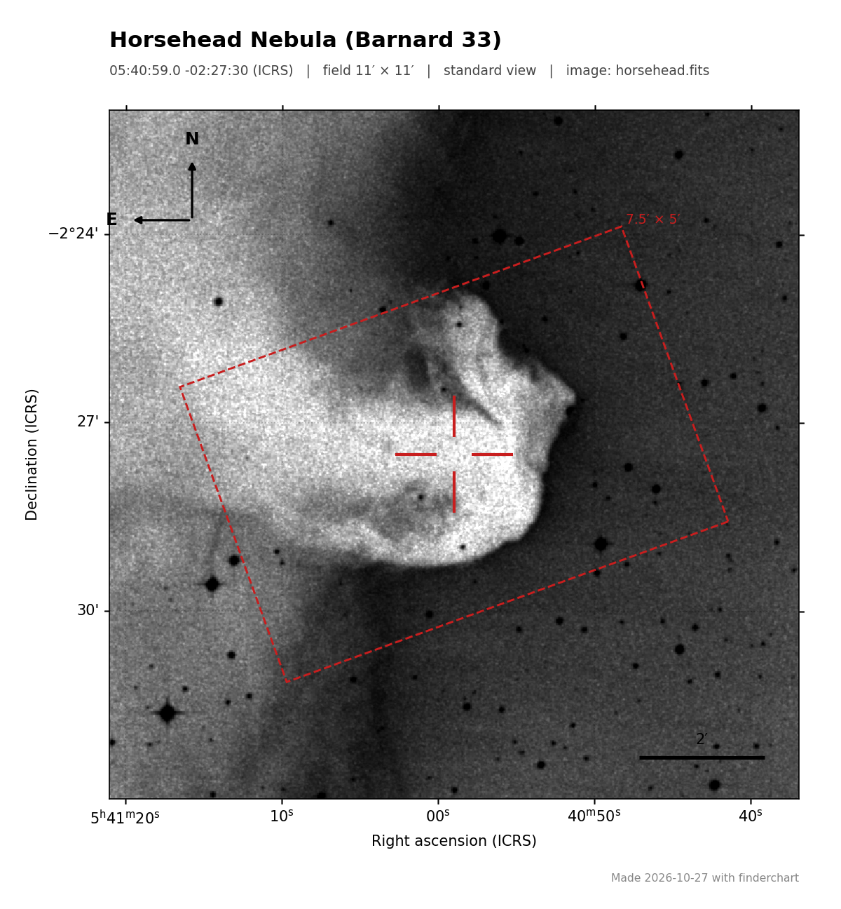
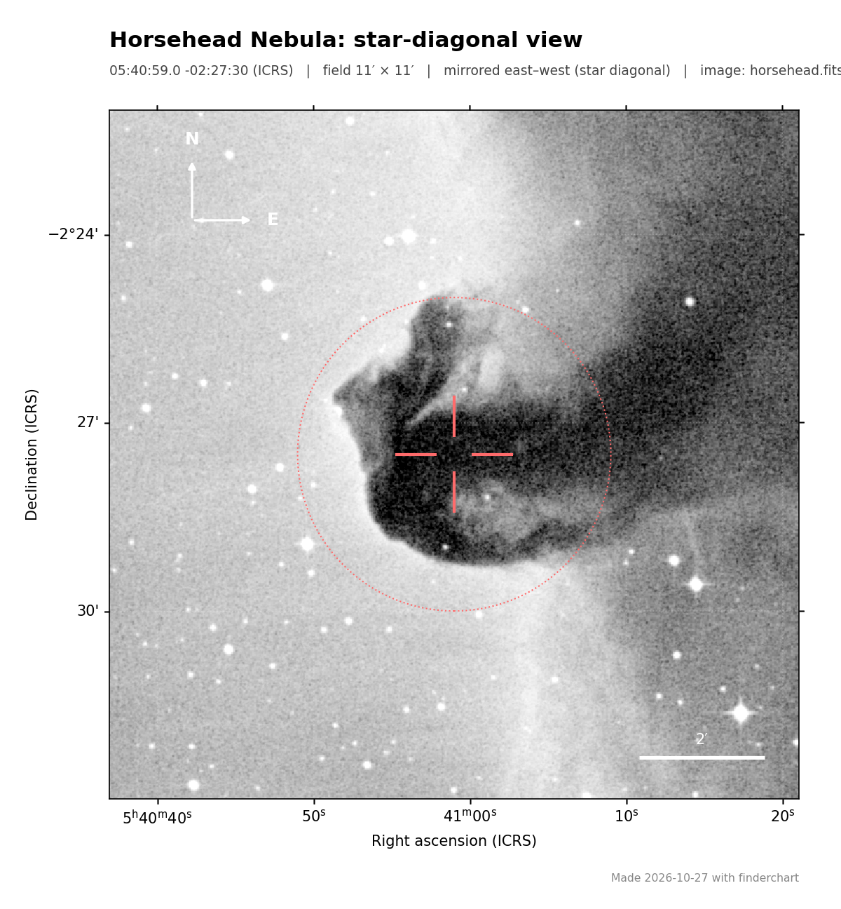

# 🔭 Finder Chart Generator


Print-ready **finder charts** for any sky target, from survey images (DSS2, 2MASS and SDSS via NASA SkyView) or your own FITS images. Coordinates, north and east arrows and the scale bar all come from the image’s World Coordinate System (WCS), so the chart is correct for any declination, rotation or mirroring.


*Horsehead Nebula from a Digitized Sky Survey plate, with a 7.5′ × 5′ camera field at position angle 20°.*

## Features

- **Any target:** an object name (resolved through SIMBAD/Sesame) or coordinates in any common format.
- **Survey or your own image:** DSS2 red, blue and infrared, 2MASS J/K and SDSS r from SkyView, or any FITS file with a WCS.
- **Correct orientation:** an RA/Dec grid with sexagesimal labels, plus north and east arrows computed from the WCS.
- **Eyepiece views:** `--mirror` for a star diagonal and `--rotate180` for a Newtonian; arrows and labels follow.
- **Planning aids:** your camera field at any position angle, circles of any radius, a target reticle and an automatic scale bar.
- **Comparison stars:** Gaia DR3 stars labelled AAVSO-style (G = 11.43 becomes “114”), moved to the observing date with their proper motions and exported to CSV with separation and position angle.
- **Print-friendly:** black stars on white by default, with asinh, sqrt, log or linear contrast stretch.
- **Batch mode:** one chart per row of a CSV target list.
- **Output:** PNG, PDF or SVG at any resolution.


*The same field as seen through a star diagonal (`--mirror`), in white-on-black.*

## Installation

```bash
git clone https://github.com/Jiqbal-astro/finder-chart-generator.git
cd finder-chart-generator
pip install -e .            # installs the `finderchart` command
```

## Usage

```bash
# By name, with a 20′ field from DSS2 red
finderchart "M 57" --fov 20

# By coordinates, from DSS2 blue, as a PDF
finderchart "02h20m30s +57d07m00s" --fov 45 --survey dss2b -o double_cluster.pdf

# Variable-star chart: camera field, Gaia comparison stars down to G = 13, CSV of the comparisons
finderchart "SS Cyg" --fov 20 --instrument 21.5x14.3 --pa 0 --gaia 13 --labels 12 --stars-csv sscyg_comps.csv

# Your own image, mirrored for a star diagonal
finderchart "05h40m59s -02d27m30s" --fits my_image.fits --fov 15 --mirror

# Many targets at once
finderchart --batch examples/targets.csv -o charts/
```

The original script still works. `python finder_chart.py` with no arguments makes the Double Cluster (NGC 869 and NGC 884) chart as before, now correctly oriented.

| Option | Default | Description |
|---|---|---|
| `target` | | Object name or coordinates (`02h20m30s +57d07m00s`, `02:20:30 +57:07:00`, `35.125 57.117`) |
| `--fov` | 30 | Field of view in arcminutes |
| `--survey` | dss2r | `dss2r`, `dss2b`, `dss2ir`, `dss`, `2massj`, `2massk`, `sdssr`, or any SkyView survey name |
| `--fits` | | Use a local FITS image instead of downloading one |
| `-o, --output` | `finder_<target>.png` | Output file (`.png`, `.pdf`, `.svg`), or a folder with `--batch` |
| `--instrument WxH` | | Camera field in arcminutes, e.g. `21.5x14.3` |
| `--pa` | 0 | Camera position angle, degrees east of north |
| `--circle R` | | Circle of radius R arcmin (repeatable) |
| `--gaia G` | | Label Gaia DR3 stars brighter than G |
| `--labels N` | 15 | How many Gaia stars to label |
| `--epoch` | today | Epoch for Gaia proper motions |
| `--stars-csv` | | Write the labelled comparison stars to CSV |
| `--mirror` / `--rotate180` | | Star-diagonal / Newtonian view |
| `--stretch` | asinh | Contrast: `asinh`, `sqrt`, `log`, `linear` |
| `--no-invert`, `--no-grid`, `--no-reticle` | | White on black; hide grid; hide target marker |
| `--batch FILE` | | CSV with a `target` column (optional `fov`, `title`) |
| `--dpi` | 150 | Output resolution |

The same tools are available from Python:

```python
from finderchart import core

center = core.resolve_target("05h40m59s -02d27m30s")
data, wcs, header = core.load_fits("tests/horsehead_dss.fits")   # or core.fetch_survey_image(...)
data, wcs = core.cutout(data, wcs, center, fov_arcmin=6)
opts = core.ChartOptions(title="Horsehead Nebula", instrument=(5, 3.3), instrument_pa=20)
core.save_chart(core.make_chart(data, wcs, center, opts), "horsehead.png")
```

## What changed from the original script

The first version labelled the chart linearly in pixels, which gave three errors that matter at the telescope:

1. **The east arrow pointed the wrong way.** On a standard north-up sky image east is on the **left**; the original arrow pointed right.
2. **The RA labels were off by about 2×.** RA was treated as a linear offset in degrees with no cos(Dec) factor, so at Dec +57° the labels were wrong by a factor of 1.84, and they also increased in the wrong direction.
3. **The field label was wrong.** The chart said 50′ × 50′ for a 45′ download.

All three now come from the WCS, and tests check each of them.

## Tests

```bash
pip install pytest
pytest
```

There are 29 tests and none needs the internet. The image tests use a cutout of a real Digitized Sky Survey plate with its WCS. SkyView, Gaia and the name resolver are replaced by fakes. The tests cover:

- coordinate parsing and name resolution;
- north and east arrows on real and rotated WCSs;
- the cos(Dec) RA span, the camera rectangle and its position angle, and the scale bar;
- proper-motion propagation, comparison-star labels and the CSV export;
- mirrored and rotated views;
- the command line, including batch mode and error messages.

## Acknowledgements

The Digitized Sky Surveys were produced at the Space Telescope Science Institute under U.S. Government grant NAG W-2166. The example image is a DSS (SERC-ER) plate distributed with the [astropy-data](https://github.com/astropy/astropy-data) tutorials. Survey images are served by [NASA SkyView](https://skyview.gsfc.nasa.gov/). This work has made use of data from the European Space Agency mission *Gaia*, processed by the Gaia DPAC. The tool is built on [Astropy](https://www.astropy.org) and [Astroquery](https://astroquery.readthedocs.io).

## Author

**Javed Iqbal**: astronomy researcher working on exoplanets and variable stars
[GitHub](https://github.com/Jiqbal-astro) · [Website](https://jiqbal-astro.github.io) · [LinkedIn](https://www.linkedin.com/in/jiqbal-astro/)

Released under the [MIT License](LICENSE).
